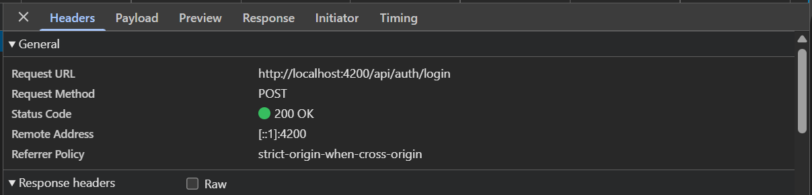
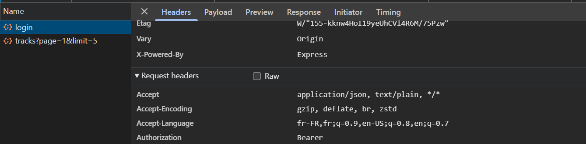

# Rapport d'usage de l'IA - TP1

Pour chaque mission, détailler et fournir des explications concernant : objectif; prompt principal; plan proposé par l'agent; vérifications réalisées par le binôme; erreurs ou propositions rejetées; fichiers effectivement modifiés; preuve de fonctionnement; ce que chaque membre sait maintenant expliquer sans l'agent.

## Préparation obligatoire avant la séance

Vérifier que le backend démarre, tester `GET /api/health`, vérifier le compte de démonstration dans MongoDB Atlas, tester le frontend, se connecter, uploader des fichiers audio et observer les requêtes dans les DevTools (onglet Network, filtre Fetch/XHR). Question : où se trouvent les traces du backend et comment les voir ?

### Prompts utilisés

- « Donne-moi les commandes pour lancer le backend et le frontend. »
- « Où le sujet demande-t-il d'utiliser l'onglet Network et le filtre Fetch/XHR ? »

### Vérifications réalisées

- Lancement du backend : connexion à MongoDB Atlas réussie, `GET /api/health` répond `{"status":"ok"}`.
- Le compte de démonstration existe : le backend affiche `[startup] Compte de démonstration déjà présent`.
- Cible de `proxy.conf.json` : `http://localhost:3000`, c'est-à-dire le port du backend. Angular tourne sur le port 4200 et le proxy redirige les requêtes `/api/...` vers le backend.
- Lancement du frontend sur `http://localhost:4200` et connexion avec le compte de démonstration.
- Lecture des traces du backend pendant la connexion : `POST /api/auth/login -> 200`, puis `[auth] Token accepté` et `GET /api/tracks?page=1&limit=5 -> 200`.
- Observation d'un ancien token resté dans `localStorage` : le backend répond `401` avec `jwt expired`, ce qui confirme que les routes protégées sont vérifiées côté serveur.

### Réponse : où se trouvent les traces du backend et comment les voir ?

Les traces du backend s'affichent dans le terminal où le backend a été lancé avec `npm start`. Pour les voir, il suffit de garder ce terminal ouvert et d'utiliser l'application : chaque requête reçue par le serveur y écrit une ligne, par exemple `[http] POST /api/auth/login -> 200`. Ces traces sont différentes de l'onglet Network du navigateur, qui montre les requêtes côté front.

### Preuves

<!-- Captures à insérer -->

## Mission 0 — Cartographier l’application

Sans modifier le code au début, retrouver :

- le composant racine ;
- la configuration des routes ;
- l’enregistrement de `HttpClient` ;
- les modèles, services et pages ;
- le mécanisme qui ajoute le JWT aux requêtes protégées.

Produire un schéma annoté du flux lors d’un clic sur « Se connecter ». Ouvrir `API_CONTRACT.md` et distinguer les routes publiques des routes protégées.

**Assistant utilisé :** Claude Code (extension VS Code), modèle Claude Opus 5.5.

### 1. Objectif

Comprendre l'organisation du frontend Angular et le trajet d'une requête de connexion..

### 2. Prompt principal

> « salut Claude, fais un passage de tous les fichiers de ce projet de manière à ce que tu puisses bien maîtriser le projet pour répondre à mes questions, je vais rédiger les réponses mais cependant tu devras rédiger par rapport à mes réponses les prompts utilisés dans le fichier RAPPORT_IA_MODELE »

Prompts de compréhension (composant racine) :

- « pourquoi on considère ceci comme étant le composant principal ? »
- « j'ai pas compris l'argumentaire »
- « le fait que le router-outlet soit dans app fait de lui le composant principal ? J'avais directement vu que c'était lui, mais je n'avais pas l'explication avec le jargon informatique »
- « ça veut dire quoi être bootstrappé concrètement ? »
- « c'est ce composant précisément qui est bootstrappé ? » (code de `app.ts` sélectionné)
- « main.ts ça représente quoi ? index.html c'est le HTML du main.ts ? »

Prompts lors de la reprise :

- « Passe en revue ce qui est déjà rédigé dans le rapport : quels points principaux sont faits, et lesquels manquent ? »
- « Comment distinguer les routes publiques des routes protégées ? S'agit-il des routes liées à l'authentification ? »
- « Que représente l'onglet Headers dans DevTools : l'ensemble des informations de la requête (URL, méthode, statut), ou seulement une partie ? »
- « Pourquoi l'en-tête contient-il à la fois Authorization et Bearer ? »

### 3. Plan proposé par l'agent

J'ai demandé à l'agent de parcourir le projet pour être guidé pas à pas dans la compréhension du code, en répondant moi-même aux questions. Il a proposé de lire le projet dans l'ordre d'exécution de l'application, sans modifier le code :

1. `main.ts` : point d'entrée, composant bootstrappé et providers (`provideRouter`, `provideHttpClient`) ;
2. `components/app` : composant racine et son `<router-outlet />` ;
3. `routes.ts` : routes publiques et routes protégées par `authGuard` ;
4. `shared/` : modèles, services (`AuthService`, `TrackService`) et intercepteur JWT ;
5. `API_CONTRACT.md` : classement des routes API en publiques et protégées.

### 4. Vérifications réalisées

- Relecture des fichiers cités (`main.ts`, `app.ts`, `routes.ts`, `auth.interceptor.ts`) pour confirmer les explications de l'agent.
- Vérification dans les DevTools (onglet Network, filtre Fetch/XHR) que l'intercepteur ajoute l'en-tête `Authorization: Bearer <token>` aux requêtes vers l'API :
  - `POST /api/auth/login` → `200 OK` ;
  - `GET /api/tracks?page=1&limit=5` → `304 Not Modified` (réponse déjà en cache, donc réussite), avec `Authorization: Bearer <token>` dans les *Request headers*.

**Remarque :** sur la requête `POST /api/auth/login`, l'en-tête `Authorization: Bearer <token>` est aussi présent. Cela s'explique par un token d'une connexion précédente, encore stocké dans le `localStorage` du navigateur. L'intercepteur ajoute le token à toutes les requêtes dès qu'il en existe un, y compris sur une route publique. Le backend ne vérifie pas ce token sur `/api/auth/login`, donc cela n'a pas d'effet sur la connexion.

### 5. Erreurs ou propositions rejetées

Proposition rejetée : l'agent a proposé une organisation du rendu (noms de dossiers de captures, sections de README) qui ne venait pas des consignes. Elle a été refusée pour suivre uniquement les documents du sujet.

### 6. Fichiers effectivement modifiés

Aucun fichier de code modifié

### 7. Preuve de fonctionnement

<!-- Captures Network à insérer (tokens masqués) : login General, login Request headers, tracks General, tracks Request headers -->

**Requête de connexion (`login` → General)** : `POST /api/auth/login`, statut `200 OK`. La connexion est envoyée à la bonne route et réussit.

**Requête de connexion (`login` → Request headers)** : l'en-tête `Authorization: Bearer` est présent car un token d'une connexion précédente était encore stocké dans le `localStorage` (voir la remarque de la rubrique 4). Le token n'apparaît pas sur la capture.

### 8. Ce que chaque membre sait maintenant expliquer sans l'agent

- Le composant Racine est app , dont le chemin est frontend-starter/src/app/components/app
En effet il s'agit de l'application principale regroupant les éléments du site web.
La classe `AppComponent` est **bootstrappée** dans le point d'entrée `main.ts` (`bootstrapApplication(AppComponent, …)`) et rendue dans la balise `<app-root>` de `index.html`. Son template contient la navigation commune et le `<router-outlet />`, où s'affichent les pages selon l'URL.
- La configuration des routes : fichier `frontend-starter/src/app/routes.ts`, enregistré dans `main.ts` via `provideRouter(routes)`.
  - `/login` → `LoginPageComponent` et `/register` → `RegisterPageComponent` : routes publiques.
  - `/profile` et `/tracks` sont protégées par `authGuard` (`canActivate`) : sans token, l'utilisateur est redirigé vers `/login`.
  - L'URL vide `''` redirige vers `/tracks`, ainsi que toute URL inconnue (`'**'`).
- L'enregistrement de `HttpClient` : dans `frontend-starter/src/main.ts`, ligne `provideHttpClient(withInterceptors([authInterceptor]))` du tableau `providers` de `bootstrapApplication`.
  - `HttpClient` est l'outil d'Angular pour envoyer des requêtes HTTP (GET, POST, PUT…) au backend.
  - `provideHttpClient` l'enregistre pour toute l'application : un service peut ensuite l'obtenir avec `inject(HttpClient)` (ex. `AuthService`).
  - Les `import` en haut du fichier rendent seulement les fonctions disponibles ; c'est leur appel dans `providers` qui active réellement `HttpClient`.
- Les modèles, services et pages : `shared/` regroupe le code partagé utilisé par les pages (guards, interceptors, modèles, services) ; ce ne sont pas des composants (pas de template HTML).
  - **Modèles** (`shared/models/`) : interfaces TypeScript qui décrivent la forme des données échangées avec l'API : `User` (utilisateur), `Track` (piste audio), `AuthResponse` (réponse du login/register : `token` + `user`), `Page<T>` (liste paginée).
  - **Services** (`shared/services/`) : seuls endroits qui appellent `HttpClient`.
    - `AuthService` : `login`, `register`, `logout`, `profile` (lecture du profil), `update` (modification du nom) ; garde l'état de connexion dans les Signals `currentUser` et `token`.
    - `TrackService` : `list` (liste paginée des pistes), `upload` (envoi d'un fichier audio), `audio` (récupération du son).
  - **Pages** (`components/`) : vrais composants Angular (classe `@Component` + template HTML), qui passent par les services sans appeler `HttpClient` directement.
    - `app` : composant racine (navigation + `<router-outlet />`) ;
    - `login-page` → `/login`, `register-page` → `/register`, `profile-page` → `/profile`, `tracks-page` → `/tracks`.
- Le mécanisme qui ajoute le JWT : l'intercepteur `frontend-starter/src/app/shared/interceptors/auth.interceptor.ts`, branché sur `HttpClient` par `withInterceptors([authInterceptor])` dans `main.ts`.
  - Toutes les requêtes HTTP vers l'API passent par lui avant de partir (il ne concerne pas les routes Angular du navigateur).
  - Si un token existe (Signal `token` de `AuthService`, initialisé depuis `localStorage`), il clone la requête et ajoute l'en-tête `Authorization: Bearer <token>` ; sinon la requête part telle quelle.
  - Le backend lit cet en-tête pour reconnaître l'utilisateur sur les routes protégées.
- Schéma du flux « Se connecter » :
- Routes publiques / protégées (d'après `API_CONTRACT.md` : « Sauf inscription et connexion, envoyer `Authorization: Bearer <token>` ») :
  - **Publiques** (sans JWT) : `GET /api/health`, `POST /api/auth/register`, `POST /api/auth/login`. Elles doivent l'être, puisque c'est en s'inscrivant ou en se connectant qu'on obtient le token.
  - **Protégées** (en-tête `Authorization: Bearer <token>` ajouté par `authInterceptor`) : `GET /api/users/me`, `PUT /api/users/me`, `GET /api/tracks`, `POST /api/tracks`, `GET /api/tracks/:id/audio`, `DELETE /api/tracks/:id`. Sans token valide, le backend répond `401`.

  